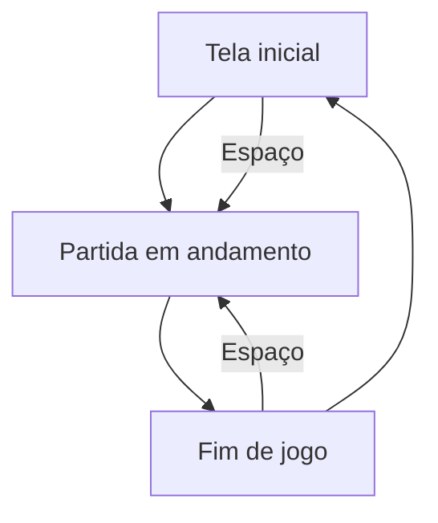

# Design: Chuva de Bugs

## Visão geral
O jogo será construído como uma página estática em HTML, CSS e JavaScript puro, com um único loop principal em `requestAnimationFrame`. A arquitetura prioriza clareza e rapidez: cada responsabilidade fica separada em módulos pequenos, e toda constante ajustável é centralizada em um objeto `CONFIG` para facilitar ajuste futuro.

A lógica será organizada em torno de um estado global do jogo, que representa a tela atual, o jogador, os itens que caem e o recorde persistido no navegador. O fluxo será simples: tela inicial → partida → fim de jogo → reinício.

## Fluxo das telas

## Estrutura de arquivos
| Arquivo | Responsabilidade |
|---|---|
| `index.html` | Estrutura da página, canvas e textos visuais. |
| `style.css` | Layout centralizado, tema escuro e aparência do jogo. |
| `src/main.js` | Ponto de entrada, inicialização e loop principal. |
| `src/config.js` | Objeto `CONFIG` com valores ajustáveis do jogo. |
| `src/input.js` | Leitura de teclado e mapeamento de ações. |
| `src/game.js` | Estado do jogo, atualização, colisões, pontuação e dificuldade. |
| `src/render.js` | Desenho do fundo, dev, itens, HUD e telas. |
| `src/storage.js` | Leitura e escrita do recorde no `localStorage`. |

## Estado do jogo
O estado será mantido em um único objeto para simplificar a lógica de atualização e renderização. Ele deve conter:

- `screen`: valor entre `initial`, `playing` e `gameOver`.
- `player`: posição horizontal, largura, altura e vidas.
- `score`: pontuação atual.
- `bestScore`: maior pontuação salva no navegador.
- `items`: lista de cafés e bugs com posição, velocidade e tipo.
- `spawnTimer`: tempo acumulado para gerar novos itens.
- `difficulty`: fator que aumenta com o tempo e acelera a queda.
- `keys`: estado das teclas de movimento (`left`, `right`) para controlar o dev de forma contínua.

## Regras de atualização
1. O loop usa `requestAnimationFrame` com delta em segundos.
2. Na tela inicial, o jogo fica aguardando a tecla Espaço.
3. Ao iniciar a partida, o estado reseta com 3 vidas e 0 pontos.
4. A cada frame, o dev se move apenas quando a tecla correspondente estiver pressionada.
5. Os itens são gerados aleatoriamente no topo com tipo aleatório entre café e bug.
6. Cada item desce com velocidade base alterada por `difficulty`.
7. Quando um café colide com o dev, a pontuação aumenta em 1 e o item é removido.
8. Quando um bug colide com o dev, a vida diminui em 1 e o item é removido.
9. Se o jogador perder todas as vidas, a tela muda para `gameOver` e a pontuação final é comparada ao recorde.
10. Na tela de fim de jogo, pressionar Espaço reinicia o estado e volta para a partida.

## Renderização
- O fundo será escuro, com visual de editor de código e linhas discretas.
- O dev será desenhado como emoji no centro inferior da área de jogo.
- Os cafés e bugs serão representados por emojis em posições X/Y sobre o canvas.
- O HUD será exibido no topo: pontuação e vidas; o recorde pode aparecer apenas no fim de jogo e no topo, se a interface permitir.
- A área do jogo terá tamanho fixo e ficará centralizada horizontalmente na tela da página.

## Persistência do recorde
O recorde será salvo com `localStorage`, usando uma chave estável e sem dependência de backend. Isso atende ao requisito de preservar a melhor pontuação mesmo após recarregar ou fechar a página.

A lógica de persistência deve seguir esta sequência:
- ao carregar a página, ler o valor salvo;
- ao encerrar a partida, comparar a pontuação atual com o recorde;
- se a nova pontuação for maior, atualizar o valor em memória e no navegador.

## Tabela de ajuste (`CONFIG`)
A tabela abaixo lista os valores que devem ficar no objeto `CONFIG`, exportado de `src/config.js`, e não espalhados pelo restante do código.

| Nome | Tipo | Propósito |
|---|---|---|
| `GAME_WIDTH` | número | largura fixa da área do jogo. |
| `GAME_HEIGHT` | número | altura fixa da área do jogo. |
| `PLAYER_WIDTH` | número | largura visual do dev. |
| `PLAYER_HEIGHT` | número | altura visual do dev. |
| `PLAYER_SPEED` | número | velocidade horizontal do dev em px/s. |
| `PLAYER_BOTTOM_MARGIN` | número | distância entre o dev e a borda inferior da área. |
| `PLAYER_START_LIVES` | número | inicia em 3 vidas. |
| `ITEM_SIZE` | número | tamanho visual do café e do bug. |
| `ITEM_SPAWN_INTERVAL` | número | intervalo inicial para gerar itens. |
| `ITEM_SPAWN_MIN_INTERVAL` | número | menor intervalo possível para manter a dificuldade crescente. |
| `ITEM_SPAWN_INTERVAL_STEP` | número | redução do intervalo de spawn conforme a dificuldade avança. |
| `ITEM_COFFEE_CHANCE` | número | probabilidade de um item gerado ser café. |
| `ITEM_FALL_SPEED_VARIATION` | número | faixa de variação aleatória da velocidade dos itens. |
| `ITEM_FALL_SPEED` | número | velocidade base de queda em px/s. |
| `ITEM_FALL_SPEED_STEP` | número | incremento por aumento de dificuldade. |
| `DIFFICULTY_STEP_TIME` | número | tempo entre aumentos de dificuldade. |
| `DIFFICULTY_INCREASE_STEP` | número | aumento do fator de dificuldade a cada intervalo. |
| `GAME_TITLE` | string | nome exibido na tela inicial. |
| `START_SCREEN_TEXT` | string | texto da tela inicial: "pressione Espaço para começar". |
| `START_SCREEN_TITLE_Y` | número | posição vertical do título da tela inicial. |
| `START_SCREEN_INSTRUCTION_Y` | número | posição vertical da instrução inicial. |
| `GAME_OVER_TEXT` | string | texto da tela de fim de jogo: "pressione Espaço para jogar de novo". |
| `LOCAL_STORAGE_KEY` | string | chave para guardar o recorde no navegador. |

## Dependências de requisito
- Requisito 1: tela inicial, início da partida e mudança de estado.
- Requisito 2: controle lateral e limites de posição.
- Requisito 3: geração aleatória, colisões e remoção de itens.
- Requisito 4: vidas, pontuação e aumento de dificuldade.
- Requisito 5: fim de jogo, recorde e reinício.

## Observações de implementação
- O código deve evitar números mágicos fora de `CONFIG`.
- O uso de `localStorage` deve ser isolado em um módulo dedicado, sem espalhar acesso direto na lógica do jogo.
- A lógica de telas e a lógica de renderização devem ser separadas para facilitar manutenção.
- A experiência deve ser simples e legível, adequada a uma construção rápida em um ambiente acadêmico.
